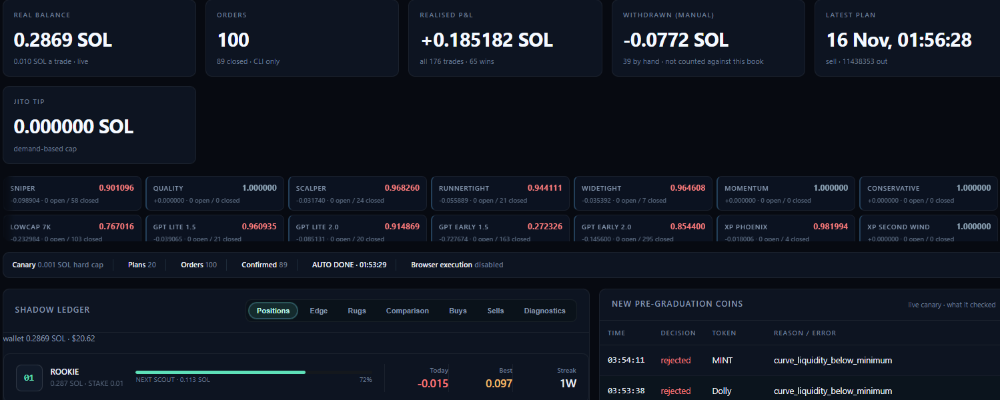
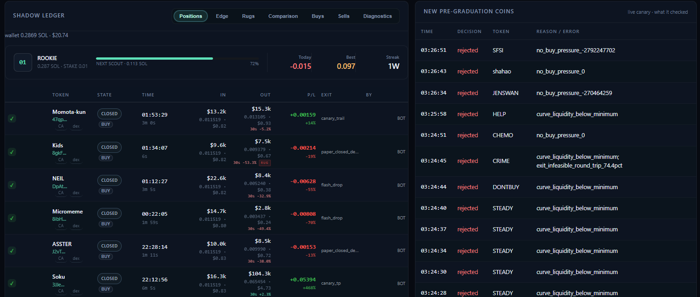

# Brand Finder Case Study

**A Solana memecoin discovery and execution-control system — how it is built, what it measures, and why it claims no edge.**

The source is private. This is the engineering write-up: the data sources, how the data is aggregated, the four execution planes, and the measurement that says the strategy does not work.



*A live instance: real balance and stake, realised P&L across 176 trades, profit manually withdrawn and kept out of the book, the per-strategy scoreboard, and the shadow ledger beside the rejection feed. Thresholds, weights and entry logic are not shown.*

---

## What it does

1. **Discovers** new tokens and graduations from a live event stream and on-chain state.
2. **Evaluates** each candidate through fail-closed safety gates — mint and freeze authority, token program and extensions, liquidity burn/lock evidence, holder and creator concentration, pool state, age and momentum.
3. **Records** every decision, rejection, curve snapshot and trade in SQLite (WAL).
4. **Simulates** the decisions through a paper arena and a shadow layer that checks whether a real quote existed.
5. **Executes** a small fixed-stake canary, with an independent guard that owns its exits.
6. **Instruments** the result: every exit is classified, and every loss can be attributed to a decision or a fill.

## Data sources

**Nine external services**, plus on-chain account decoding:

| Source | What it provides | Failure mode handled |
|---|---|---|
| PumpPortal stream | New token launches and migrations | Reconnect and gap detection |
| Solana RPC (HTTP) | Account state, balances, transaction submission | Primary/secondary/last-resort endpoints with provider statistics |
| Solana WebSocket | Account and log subscriptions | Silent-socket detection, then failover |
| On-chain program accounts | Bonding curve, PumpSwap and Raydium pool state, decoded directly | Stale-account handling; reserves read on-chain before any mark is trusted |
| Jupiter | Execution quotes and route construction | Quote rejection when the route is thin or unavailable |
| Jito | Bundle submission for the execution path | Falls back to direct submission |
| DexScreener | Aggregator price, the lowest valuation tier | Never used as a sale price — marks only |
| Telegram | Operator alerts and commands | Delivery failures logged, never fatal |
| Discord | Alert mirror | Same |

## How the data is aggregated

```text
event stream ─┐
RPC + WS ─────┼─▶ normalise ─▶ safety gates ─▶ SQLite (WAL) ─┬─▶ paper arena
on-chain ─────┘      │              │                        ├─▶ shadow layer
                     │              └─ reject + reason       └─▶ canary
                     └─ curve/price snapshots, aged and tagged with source
```

The three rules that make the aggregate trustworthy:

- **Every value carries its source and its age.** A mark that is older than its window is classified as cached or blind, never smoothed.
- **A rejection is data.** Every candidate that fails a gate is stored with the reason, so the funnel can be measured rather than guessed.
- **A mark is not a price.** The valuation ladder can trigger a decision; only a live quote can price a sale.

## Four planes, deliberately separated

| Plane | Money at risk | Question it answers |
|---|---|---|
| Engine | none | Is this token real, and does it pass the gates? |
| Paper arena | none | What would a rule have done? |
| Shadow | none | Was that fill achievable at a real quote? |
| Canary | 0.01 SOL | Does the real execution path work, and what does it cost? |

## The measurement

171 closed ledger rows, 62 wins and 109 losses, profit factor 1.22 — and the top three trades are **154%** of the profit. Excluding them the book is **−0.0833 SOL**. Seventy-four of those rows are paper or legacy rather than live.

The honest sentence: *I can defend how the system decides and executes; I cannot defend an edge, because there isn't one.*



*The shadow ledger on a live instance: every position with its state, entry and exit, realised P&L and the reason it closed; and on the right, the new-token feed showing decisions as they happen — each rejection carrying the gate that rejected it. What is not shown is how any gate is calculated.*

## Read next

- [Architecture](docs/ARCHITECTURE.md) — processes, control loop, position state, valuation ladder, durable tables
- [Failure taxonomy](docs/FAILURE-TAXONOMY.md) — ten failure classes, each with the guard and the test that pins it
- [Incident INC-001](docs/INCIDENT-INC-001.md) — eleven buys recorded nowhere, and the prevention rules that followed
- [Deployment discipline](docs/DEPLOYMENT-DISCIPLINE.md) — why the running build was not the repository head
- [Evidence](EVIDENCE.md) — what was tested, what was not, and the test-quality weaknesses

## What is not published

Source code, strategy parameters, entry and exit thresholds, scoring weights, wallet configuration and any endpoint. None of it appears in this repository.
